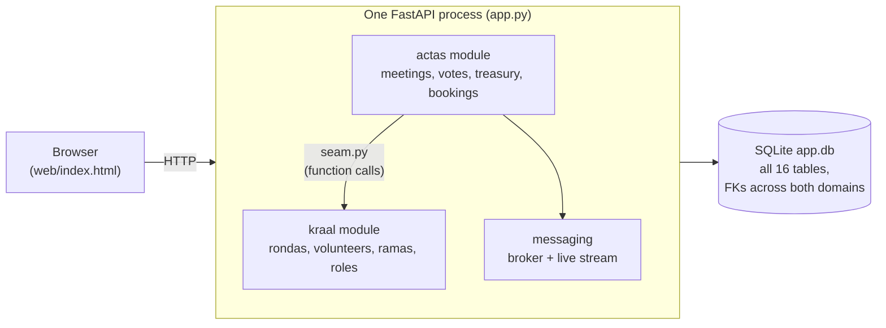
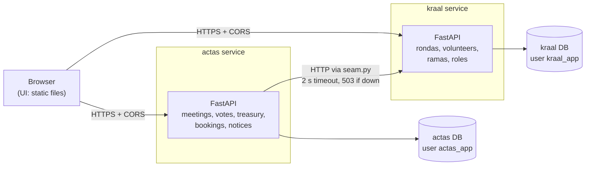
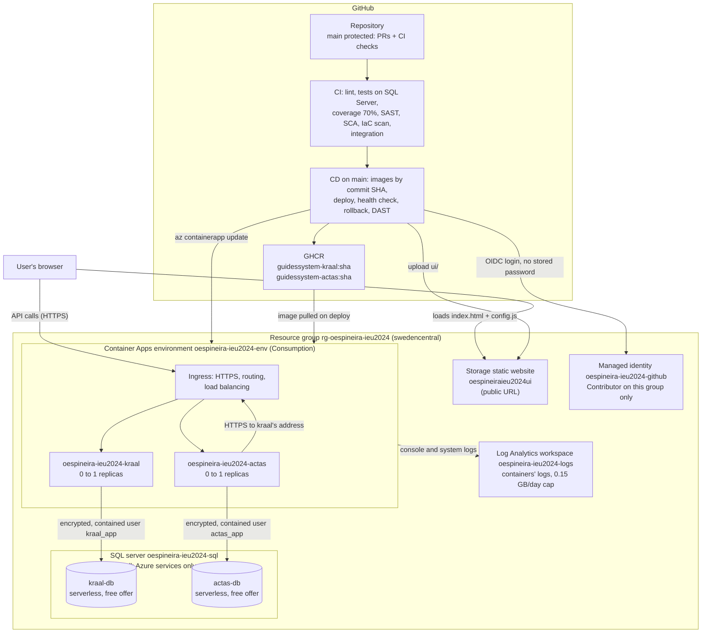
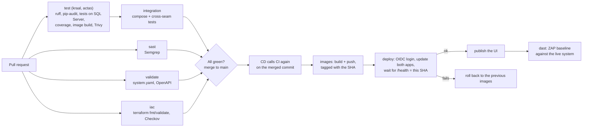
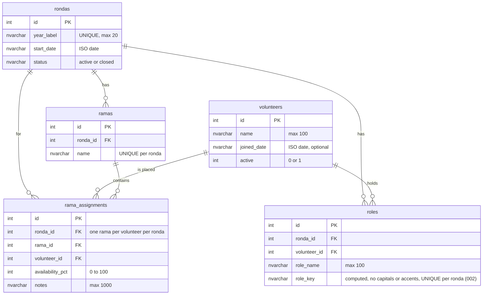
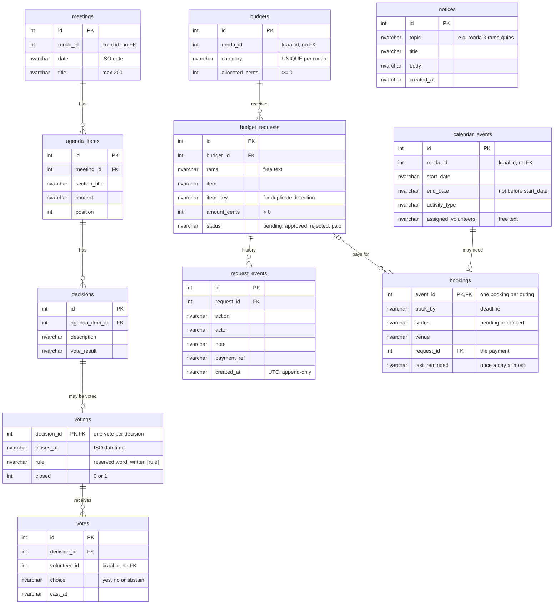

# Diagrams

All diagrams match the code and the deployment as of 28 Nov 2026. They are written in Mermaid, so GitHub draws them and they change with the code.

## 1. Before: Assignment 1, one process, one database

## 2. After: Assignment 2, two services, two databases

What changed: the seam became HTTP; the three ronda_id foreign keys across the domains became plain ids checked over HTTP at write time; each service has its own database and user, which cannot open the other one; when kraal is down, actas keeps serving its own data and returns 503 only for flows that need kraal.

## 3. Deployment on Azure

The resources are described in Terraform (infra/terraform), except the two databases, created by infra/setup.sh (the SQL free offer has no Terraform setting).

## 4. CI/CD pipeline

## 5. Kraal's database

Plus schema_migrations (version, applied_at), written by the migration runner.

## 6. Actas's database

ronda_id and volunteer_id are plain ids from kraal: checked over HTTP at write time, never foreign keys (ADR-7).

Plus schema_migrations (version, applied_at).